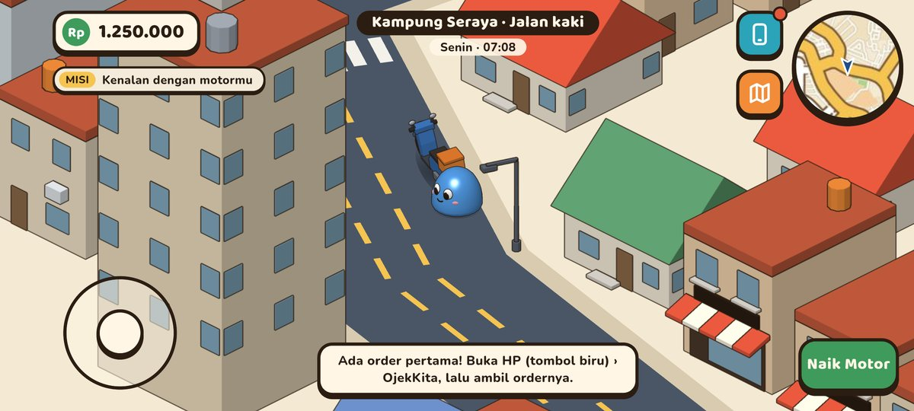
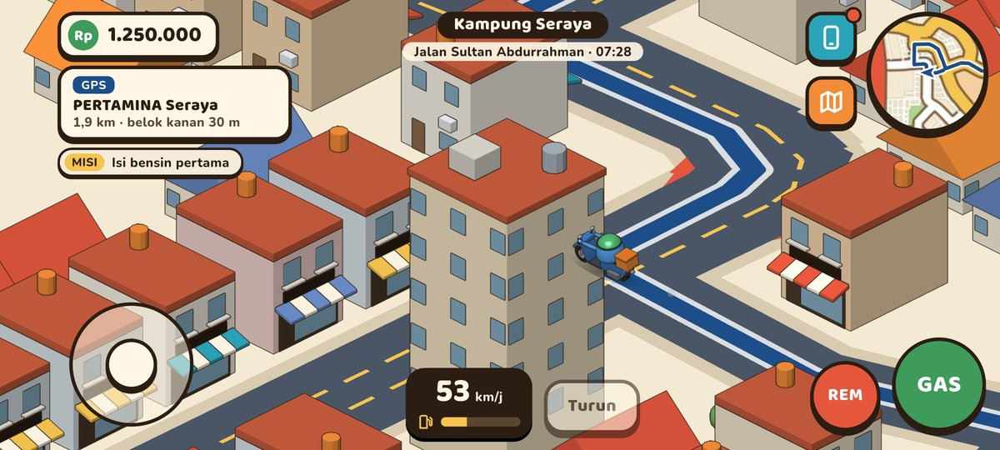
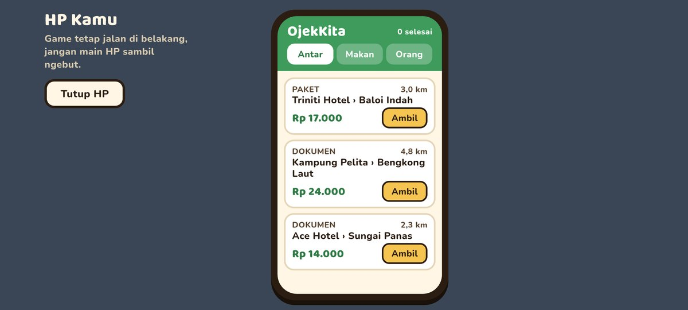
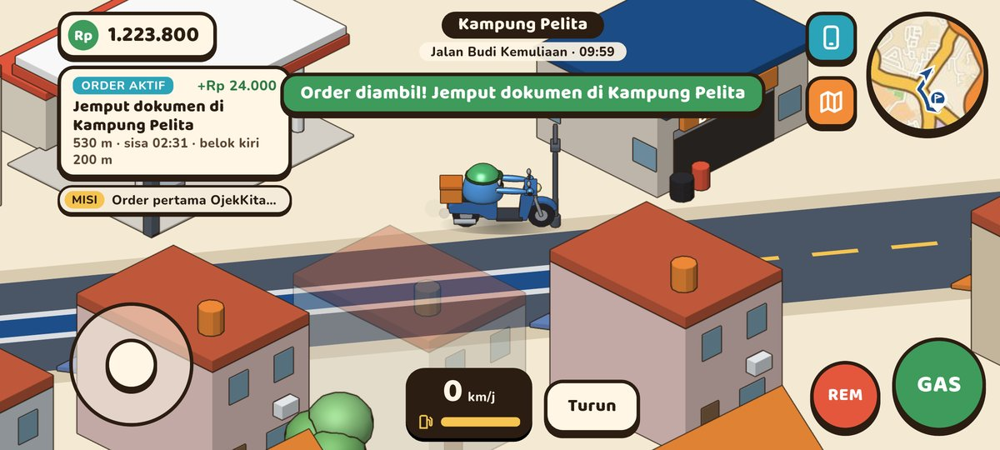
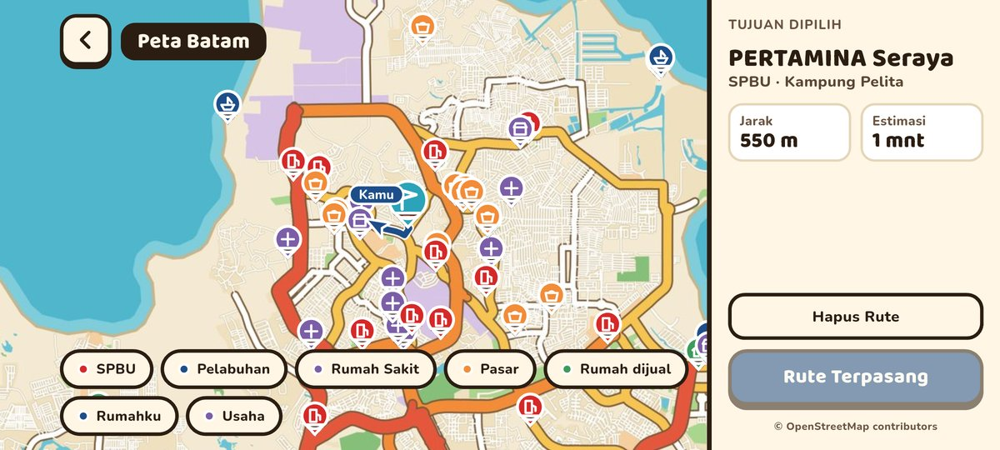
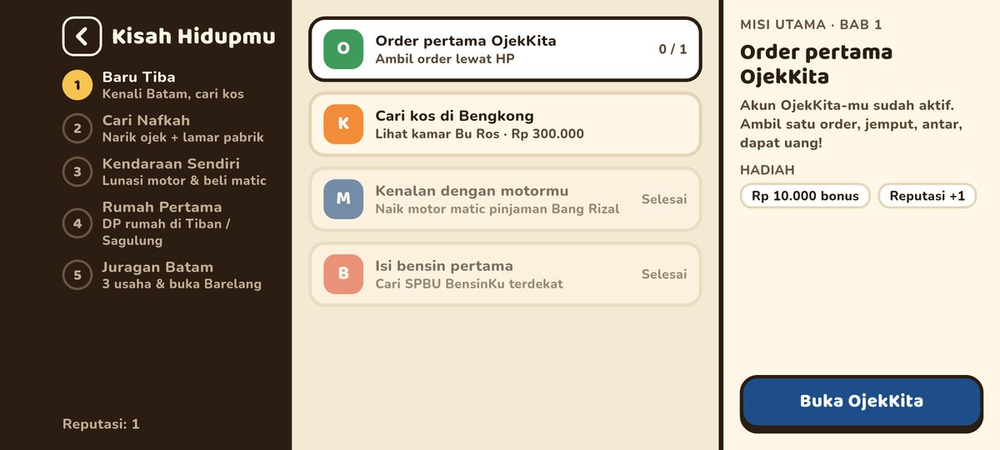
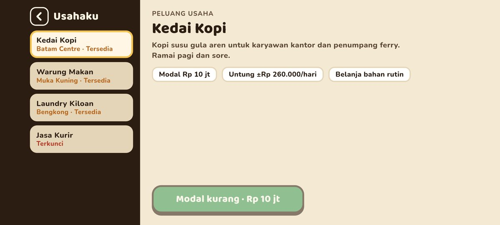
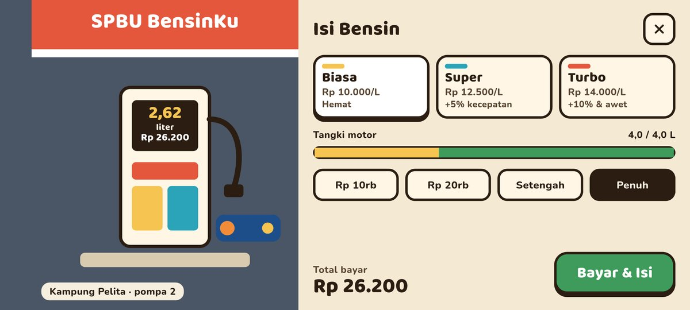
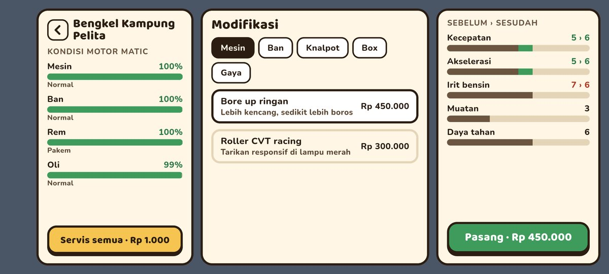
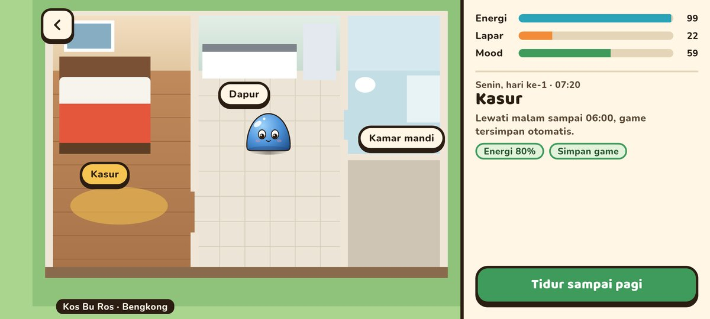

# Batam: The Journey Begins

Game mobile open-world (Flutter + Flame) berlatar seluruh Pulau Batam. Kamu jadi perantau yang baru
tiba: narik ojek, isi bensin, menabung, sewa kos, beli rumah, modifikasi motor, sampai membangun usaha
sendiri. Peta dan jalannya diambil dari data OpenStreetMap, jadi nama jalan, kelurahan, SPBU, dan
pelabuhannya sesuai Batam yang asli. Kotanya digambar isometrik bergaya kartun, dengan bangunan 3D
low-poly yang dibuat langsung di kode Dart.



## Tangkapan layar

| Naik motor | HP & OjekKita |
|---|---|
|  |  |
| **Order aktif + rute GPS** | **Peta Batam** |
|  |  |
| **Kisah Hidupmu (misi)** | **Usaha** |
|  |  |
| **SPBU BensinKu** | **Bengkel** |
|  |  |
| **Rumah (kos Bu Ros)** | |
|  | |

## Fitur

- **Dunia Pulau Batam**: graf jalan dari OpenStreetMap (trunk sampai tertiary) dengan batas darat/laut,
  digambar isometrik 2:1 (peta diputar 45°). Kamera mengikuti pemain dari dekat dan melihat ke depan
  sesuai laju motor.
- **Kota 3D prosedural**: blok bangunan muncul menurut kepadatan jalan, lengkap dengan atap, jendela,
  pohon, lampu jalan, dan zebra cross. SPBU, bengkel, rumah, dan ruko punya model sendiri. Bangunan
  yang menutupi pemain jadi tembus pandang.
- **Model low-poly di kode Dart**: kotak, silinder, bola, dan ekstrusi dengan cahaya searah dan
  outline tinta, dipanggang jadi sprite 16 arah saat load lalu di-cache.
- **Pemain slime jelly 3D** yang kenyal (squash-stretch, toleh halus, debu langkah) dan bisa jalan
  kaki atau naik motor. Joystick mengikuti arah layar.
- **Rasa berkendara**: motor miring saat belok, gas/rem bertahap, assist lajur ringan, asap knalpot,
  dan jejak rem.
- **Minimap, peta penuh, dan GPS A\*** dengan arahan belokan dan filter pin (SPBU, pelabuhan, rumah
  sakit, pasar, rumah dijual, rumahku, usaha).
- **Bensin & SPBU BensinKu**: tangki berkurang saat berkendara, isi ulang di SPBU dari POI `fuel`.
- **OjekKita**: order Antar, Makan, dan Orang lewat HP. Jemput, antar, lalu dibayar.
- **Kejadian di jalan & misi**: kartu cerita acak di jalan, misi utama bab 1–2, dan reputasi.
- **Bengkel**: keausan, servis, dan modifikasi motor (termasuk bengkel di samping setiap SPBU).
- **Rumah & kebutuhan**: jam game (1 hari = 24 menit), energi/lapar/mood, kos Bu Ros, rumah yang bisa
  dibeli tunai atau kredit.
- **Usaha**: 4 jenis usaha dengan untung harian, stok, belanja bahan, pesanan katering, dan upgrade.
- Progres tersimpan lokal (`shared_preferences`).

## Kontrol

| Aksi | Layar sentuh | Keyboard (web/desktop) |
|---|---|---|
| Jalan / setir | Joystick kiri | Panah atau WASD |
| Gas | Tombol GAS | Spasi / J |
| Rem | Tombol REM | X / K |
| Naik / turun motor | Tombol Naik Motor / Turun | E / F |
| HP, peta | Tombol biru & oranye di kanan atas | — |

## Menjalankan

Butuh Flutter 3.47 (Dart ^3.13). Proyek ini hanya punya target Android dan dimainkan dalam mode
landscape (ukuran desain acuan 844×390).

```bash
flutter pub get
flutter run            # HP Android yang tersambung
flutter test           # unit test sistem game
flutter build apk --release
```

## Struktur folder

```
lib/
  game/           BatamGame (FlameGame), proyeksi iso, kamera, kontrol
    actors/       pemain, motor, SPBU, bengkel, rumah, ruko usaha
    city/         pembuat blok kota prosedural dan lapisan kota 3D
    map/          loader graf jalan, A*, masker darat/laut, layer jalan, lantai per chunk
    model3d/      model low-poly, rasterizer, panggang sprite 16 arah
    sprites/      format sprite bersama (atlas + JSON) dan cache hasil panggang
    systems/      jam, kebutuhan, ekonomi, order, GPS, kejadian, misi, bengkel, rumah, usaha
  ui/             HUD, minimap, peta, layar HP/SPBU/bengkel/rumah/properti/usaha
assets/
  data/batam_road_graph.json   graf jalan Batam (meter, origin pojok kiri-atas bbox)
  images/batam_peta.jpg        gambar peta untuk minimap & peta penuh
docs/
  STEPS.md        daftar langkah pengerjaan berikutnya
  pr/             screenshot pendukung tiap PR
  reference/      peta referensi Batam (berlabel & polos)
  screenshots/    gambar untuk README ini
tools/map/        script Python pembuat ulang data peta dari OpenStreetMap
test/             unit test
```

Cara membuat ulang data peta ada di [tools/map/README.md](tools/map/README.md).

## Lisensi data

Data peta © [OpenStreetMap contributors](https://www.openstreetmap.org/copyright), dilisensikan di
bawah ODbL.
